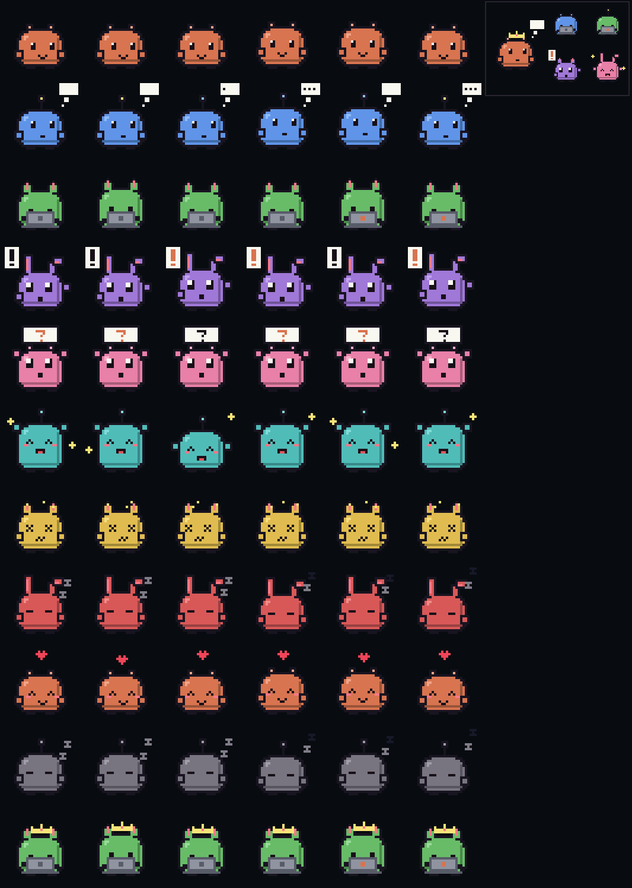

# claude-smalltv-pets

A desk pet for [Claude Code](https://code.claude.com) on a **GeekMagic SmallTV Pro**, the little 240×240 desk display with a touch button on top.

Every Claude Code session gets a pixel critter with its own colour and body. It shows what the session is doing (thinking, working, waiting for you, done, error, asleep) with a running narration ("Editing register.ts", "$ bun test"). Subagents join as named helper pets beside a crowned lead. The header shows the model and effort; bars show context fill and your 5-hour and 7-day usage. And when Claude asks for permission, you can answer with the button.



## What you need

- A **GeekMagic SmallTV Pro** (classic ESP32, 8 MB, touch button on top). Other SmallTV models are not supported.
- Claude Code 2.1.293 or later.
- The pet and your computer on the same Wi-Fi.

## The button

| Gesture | Normal | While a permission prompt waits |
| --- | --- | --- |
| tap | pet it | **allow** |
| hold (1 s) | brightness 80 → 30 → 8 % | **deny** |
| double tap | open the session picker | |

In the **session picker**, each tap moves down the list (Auto, then one row per session); stop tapping and the highlighted row is chosen after 2 seconds, or hold to choose at once. **Auto** follows whichever session needs you most; a chosen session stays on screen (a pin shows in the header) until you change it. A permission prompt from any session always comes to the front.

If nobody answers a permission prompt on the pet within 20 seconds, Claude Code's own dialog appears as usual.

## Install

### 1. Flash the firmware

> [!WARNING]
> This replaces the SmallTV's stock firmware. It has worked on a SmallTV Pro running stock firmware V3.3.76EN, but flashing is at your own risk: the Pro has no USB data connection, so if a flash goes wrong, recovery means opening the case and wiring a 3.3 V USB-UART adapter to the board. The stock firmware cannot be backed up beforehand.

1. Download `claude-smalltv-pets-<version>.bin` from the [latest release](https://github.com/kkarkos/claude-smalltv-pets/releases/latest).
2. Find the SmallTV's IP address (the stock firmware shows it on screen) and open `http://<its-ip>/update` in a browser. The stock firmware has this page even though its menu does not link to it.
3. Choose the `.bin` file, click **Update** and wait for the device to restart.

### 2. Put it on your Wi-Fi

The pet starts a Wi-Fi hotspot named **ClaudePet-Setup**. Join it with your phone; the setup page opens by itself (or go to `http://192.168.4.1`). Enter your Wi-Fi name and password. The pet restarts, joins your network and shows its address. It answers at `http://claude-pet.local` from then on.

### 3. Install the Claude Code plugin

At the Claude Code prompt:

```
/plugin install smalltv-pet --marketplace kkarkos/claude-smalltv-pets
```

Answer `y` to add the marketplace and pick the user scope. Every Claude Code session you start from then on appears on the pet. Run `/pet test` for a 15-second demo of every mood and `/pet ask` to try the button.

If `claude-pet.local` does not resolve on your network, set the pet's IP instead: `/plugin configure smalltv-pet@claude-smalltv-pets`.

## The `/pet` command

| Command | Does |
| --- | --- |
| `/pet` or `/pet status` | Whether the pet answers, and this session's state |
| `/pet test` | A 15-second demo, including an agent team |
| `/pet ask` | A test permission prompt: tap or hold and see the answer |
| `/pet approvals on` / `off` | Answer permission prompts on the pet, or not |
| `/pet color 0-7` / `auto` | Keep a colour for this project, or let the pet choose |
| `/pet body 0-3` / `auto` | Keep a body type (ear nubs, antenna, cat ears, bunny ears) |
| `/pet brightness 0-100` | Screen brightness |

Settings (`/plugin configure smalltv-pet@claude-smalltv-pets`): `deviceUrl` (default `http://claude-pet.local`) and `approvalSeconds` (default 20; 0 turns desk approvals off).

## Updating

Download the new `.bin` from the releases and upload it at `http://claude-pet.local/update`. Update the plugin with `/plugin update smalltv-pet@claude-smalltv-pets`.

## Troubleshooting

- **The pet shows "Wi-Fi setup".** It could not join your network; join the ClaudePet-Setup hotspot again and re-enter the details.
- **The pet shows "SAFE MODE".** The firmware crashed three times in a row. Wi-Fi and `http://<pet>/update` still work: flash a release `.bin` again.
- **The button does not react.** `http://claude-pet.local/api/touch` shows the raw reading; it drops when the pad is touched. Please open an issue with the values you see.
- **A closed session stays on the pet.** Sessions that end without saying goodbye (a killed terminal) are removed after 3 minutes.

## How it works

The plugin (`plugin/`) is a Claude Code mod: hooks on turns, tool calls, subagents, notifications and permission requests keep a snapshot of the session, which it sends to the pet over HTTP on your local network. Nothing leaves your network. The firmware (`firmware/`) keeps up to six sessions, picks the one to show, and draws the pet procedurally on a 32×32 grid, so each mood is a handful of parameters rather than frames.

### HTTP API

| Method | Path | Body / query |
| --- | --- | --- |
| POST | `/api/session` | `{ sid, name, state, label, color?, body?, model, effort, ctx, five, week, pats, helpers: [{ id, name, color, body, state, label }] }` |
| POST | `/api/end` | `{ sid }` |
| POST | `/api/approve` | `{ sid, id, tool, summary, timeout }` |
| GET | `:81/api/approval?id=…&wait=8` | long-poll: `{ decision: pending, allow, deny or expired }` |
| POST | `/api/cancel` | `{ id }` |
| POST | `/api/config` | `{ brightness }` |
| GET | `/api/info`, `/api/touch` | status; raw touch reading |
| GET, POST | `/update` | firmware upload (`curl -F firmware=@firmware.bin http://claude-pet.local/update`) |

## Building from source

See [CONTRIBUTING.md](CONTRIBUTING.md). In short: `cd firmware && pio run`, then `tools/flash.sh <pet-ip>`.

## Licence

MIT, see [LICENSE](LICENSE). The SmallTV Pro's pin map, panel set-up and partition table come from [smalltv-mod](https://github.com/giovi321/smalltv-mod) (WTFPL); see [CREDITS.md](CREDITS.md).

Not affiliated with GeekMagic or Anthropic.
